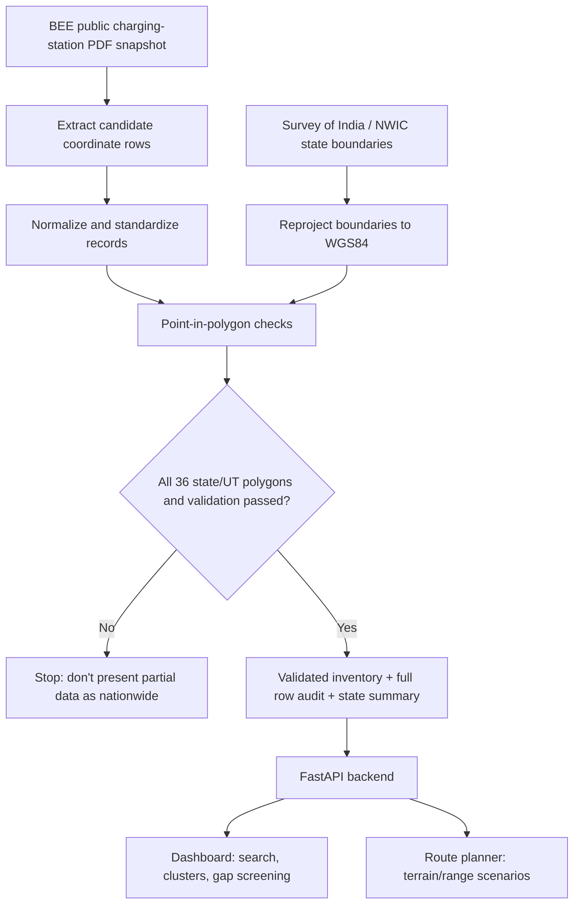
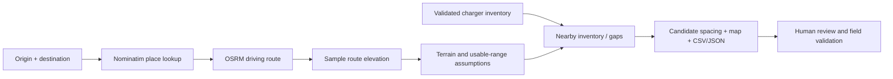

# GRIDPULSE
### India-wide EV charging infrastructure planning

**GRIDPULSE** turns public EV charging-station records into a map-first planning workflow: explore existing charger records, inspect spatial clusters, screen potential coverage gaps, and review a driving corridor against charger proximity, terrain and vehicle-range assumptions.

> **Research prototype, not a deployment approval system.** Source inventory: Bureau of Energy Efficiency (BEE), snapshot dated **26 October 2025**. Live operating status, unique physical-site count, measured charging demand and electrical grid capacity are not verified.

[Run locally](#run-locally) · [System flow](#how-it-works) · [Data validation](#data-and-validation) · [API](#api) · [Limitations](#what-the-results-mean)

---

## What it does

| Capability | Purpose |
|---|---|
| **Inventory dashboard** | Interactive map, state/region filters, search, charger summaries and exports |
| **Spatial clustering** | DBSCAN with Haversine distance groups nearby coordinate records |
| **Coverage-gap screening** | Straight-line midpoint candidates identify places to investigate further |
| **Route planner** | Driving route, sampled elevation, terrain/range assumptions and spacing scenarios |
| **India boundary validation** | Checks source points against official state/UT polygons and audits exclusions/corrections |
| **Developer API** | FastAPI endpoints with interactive OpenAPI docs |

## How it works



## Route-planning flow



The route planner is a **transparent rule-based screening tool**, not a model trained on measured charging sessions.

## Architecture

```text
GRIDPULSE
├── app/
│   ├── main.py                 FastAPI app, inventory, clustering, dashboard APIs
│   ├── geo_boundaries.py       State/UT normalization and boundary predicates
│   ├── route_api.py            Routing, elevation and spacing scenarios
│   └── static/
│       ├── index.html          Main interactive dashboard
│       └── route_planner.html  Route-planning interface
├── scripts/
│   ├── prepare_india_inventory.py  National validation + audit generation
│   ├── validate_data.py            Data validation utilities
│   └── fetch_* / render_*           Supporting data and map utilities
├── configs/regions.yaml        Region configuration
├── data/                       Raw, interim, processed and report directories
├── tests/                      API, route, region and boundary regression tests
├── INSTALL_GRIDPULSE_INDIA.md  India-wide setup and data preparation
└── requirements.txt            Python dependencies
```

## Run locally

Requirements: Python 3.10+. Run in PowerShell from the repository root:

```powershell
python -m venv .venv
.\.venv\Scripts\python.exe -m pip install --upgrade pip
.\.venv\Scripts\python.exe -m pip install -r requirements.txt
.\.venv\Scripts\python.exe -m uvicorn app.main:app --host 127.0.0.1 --port 8000
```

Open:
- Dashboard: http://127.0.0.1:8000
- Route planner: http://127.0.0.1:8000/route-planner
- API reference: http://127.0.0.1:8000/docs
- Health and configuration: http://127.0.0.1:8000/api/health

For an all-India setup, follow [INSTALL_GRIDPULSE_INDIA.md](INSTALL_GRIDPULSE_INDIA.md). A fresh clone must have the required data assets prepared: nationwide mode requires the raw BEE candidate inventory, official boundary data and a successful validation output. The app is designed to fail closed instead of silently showing a regional subset as national coverage. Generated inventory and audit outputs may be ignored by Git, so follow the preparation guide rather than assuming they are shipped in the repository.

Run tests:

```powershell
.\.venv\Scripts\python.exe -m pytest tests -q
```

## Data and validation

The BEE source parser produced **39,628 candidate rows** from a PDF snapshot. This is a source-row count, not a verified count of distinct or operational charging sites.

The nationwide preparation pipeline:
1. Loads the required state/UT polygons from Survey of India / NWIC.
2. Converts the boundary geometries from the source coordinate reference system to WGS84 longitude/latitude.
3. Normalizes state/UT name variants and checks each candidate point against polygons.
4. Keeps covered points, corrects a state label only when another polygon uniquely covers the point, and excludes unresolved/outside records.
5. Writes the accepted inventory, a row-level audit and a state/UT summary.

Sources: [BEE EV public charging-station data](https://www.beeindia.gov.in/show_content.php?lang=1&level=2&lid=67&ls_id=345) · [Survey of India / NWIC state-boundary dataset](https://nwdp.nwic.gov.in/dataset/state-boundary)

## API

Use `/docs` on the running application to inspect exact endpoint paths, schemas and responses. It is the canonical reference for the installed code version.

## What the results mean

**Good for:** initial spatial exploration, clustering, route inventory review, configurable spacing scenarios and candidate generation for field investigation.

**Not verified by this application:** live station uptime, unique physical-site deduplication, real traffic, measured charging demand, a trained EV-demand forecast, land availability, road access permissions, procurement pricing, feeder/transformer capacity, grid hosting capacity, voltage drop, permits or construction approval. Proposed points are hypotheses for review—not confirmed construction sites.

### External services

Route planning may use public Nominatim geocoding, OSRM routing and Open-Meteo elevation. Internet access is required for new lookups; these are best-effort public services, not production availability guarantees. Respect OpenStreetMap attribution and service usage policies.

## Branch and integration status

- [Nationwide boundary-validation PR #3](https://github.com/AnshXGrind/ev-proje/pull/3) — open; review merge conflicts/status before integration.
- [Northeast expansion PR #1](https://github.com/AnshXGrind/ev-proje/pull/1) — merged.
- [Central-state expansion PR #2](https://github.com/AnshXGrind/ev-proje/pull/2) — merged.

The default branch is `main`; this README was updated on the nationwide feature branch. Check the branch shown in GitHub before presenting the project. After merging, verify the running app using `/api/health` and the local test suite.

---

**GRIDPULSE — map the inventory, screen the gaps, validate before deployment.**
