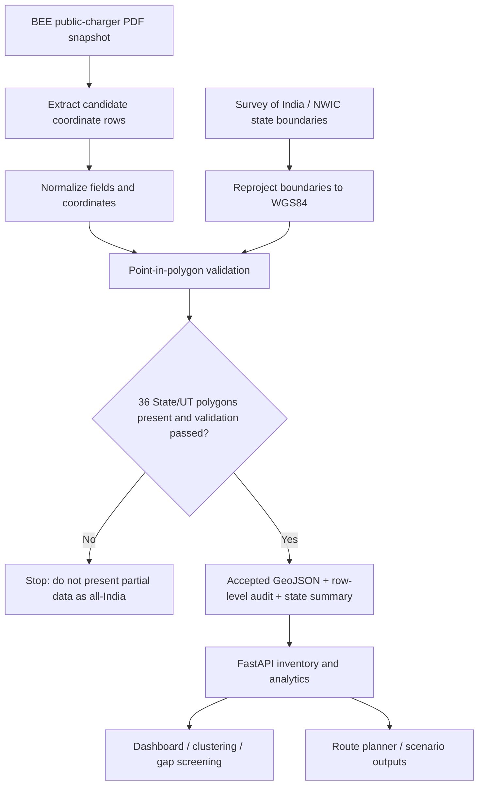
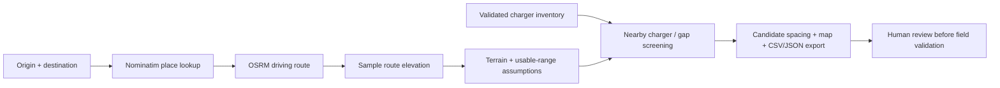

# GRIDPULSE
### India-wide EV charging infrastructure planning

**GRIDPULSE** turns a dated public charging-station inventory into a map-first planning workflow: inspect existing charger records, identify *candidate* coverage gaps, and screen a driving corridor against charger proximity, terrain and vehicle-range assumptions.

> **Research prototype, not a deployment approval system.** Inventory source: Bureau of Energy Efficiency (BEE), snapshot dated **26 October 2025**. Operating status, unique physical-site count, traffic demand and electrical grid capacity are not verified by this repository.

[Dashboard](#run-locally) · [Architecture](#how-it-works) · [Data pipeline](#data-and-validation) · [API docs](#api) · [Limitations](#what-the-results-mean)

---

## At a glance

| Layer | What it does |
|---|---|
| **Explore** | Interactive map, region/state filters, charger detail search, inventory summaries and exports |
| **Cluster** | DBSCAN with Haversine distance groups nearby coordinate records for spatial inspection |
| **Screen gaps** | Straight-line midpoint candidates offer a first-pass view of potential coverage gaps |
| **Plan a route** | OSRM driving geometry + sampled elevation + transparent range/reserve/terrain scenarios |
| **Validate India coverage** | Official state/UT boundaries validate coordinates; excluded/corrected source rows are audited |
| **Inspect API** | FastAPI endpoints and interactive OpenAPI documentation |

## How it works



## Route-planning flow



The route tool is a **transparent rule-based screen**, not a model trained on measured charging sessions. It does not replace utility feasibility studies or site surveys.

## Architecture

```text
GRIDPULSE
├── app/
│   ├── main.py                FastAPI app, inventory loading, clustering & dashboard APIs
│   ├── geo_boundaries.py      State-name normalization and boundary predicates
│   ├── route_api.py           Geocoding, road route, elevation and spacing scenarios
│   └── static/
│       ├── index.html         Main interactive dashboard
│       └── route_planner.html Route planner interface
├── scripts/
│   ├── prepare_india_inventory.py  National boundary validation + audit generation
│   ├── validate_data.py            Data checks
│   └── render_* / fetch_*           Supporting data and map utilities
├── configs/regions.yaml      Region configuration
├── data/                      Raw/interim/processed/reports (generated data is ignored)
├── tests/                     Regression tests for API, route logic, regions and boundaries
├── INSTALL_GRIDPULSE_INDIA.md India-wide installation and data notes
└── requirements.txt           Runtime + test dependencies
```

## Run locally

Python 3.10+ is required. In PowerShell, from the repository root:

```powershell
python -m venv .venv
.\.venv\Scripts\python.exe -m pip install --upgrade pip
.\.venv\Scripts\python.exe -m pip install -r requirements.txt
.\.venv\Scripts\python.exe -m uvicorn app.main:app --host 127.0.0.1 --port 8000
```

Open:
- Dashboard: http://127.0.0.1:8000
- Route planner: http://127.0.0.1:8000/route-planner
- API reference: http://127.0.0.1:8000/docs
- Health/configuration: http://127.0.0.1:8000/api/health

For a fresh clone, install or generate the data assets described in [INSTALL_GRIDPULSE_INDIA.md](INSTALL_GRIDPULSE_INDIA.md). Nationwide mode requires the raw BEE candidate inventory and official boundary dataset to be prepared and validated; the app is designed to fail closed instead of silently presenting a regional subset as nationwide data. Keep raw data, generated reports and processed map assets local unless intentionally publishing a reviewed, redistributable dataset.

Run tests:

```powershell
.\.venv\Scripts\python.exe -m pytest tests -q
```

## Data and validation

The India-wide source contains **39,628 parsed candidate rows** from the BEE PDF snapshot. This number is not a count of distinct, currently operating physical stations.

The national preparation flow:
1. Loads all required state/UT polygons from the Survey of India / NWIC boundary dataset.
2. Reprojects source boundary geometry from its source CRS to WGS84 (longitude/latitude) before comparing charger points.
3. normalizes state/UT spelling variants and performs point-in-polygon checks.
4. Retains rows supported by polygon coverage, corrects a state label only when uniquely covered by another state/UT polygon, and excludes unresolved/outside points.
5. Writes the validated inventory, row-level audit and per-state/UT summary for review.

Official source links:
- [BEE EV public charging-station data](https://www.beeindia.gov.in/show_content.php?lang=1&level=2&lid=67&ls_id=345)
- [Survey of India / NWIC state-boundary dataset](https://nwdp.nwic.gov.in/dataset/state-boundary)

## API

Use the OpenAPI page at `/docs` to inspect and execute available endpoints. Key categories include health/configuration, inventory and search, regional summaries, spatial clustering, coverage-gap screening, boundary/source audit and route planning. Exact request schemas are defined by the running API, so treat `/docs` as the canonical endpoint reference.

## What the results mean

**Useful for:** early spatial exploration, record clustering, corridor inventory review, parameterized spacing scenarios, and producing candidates for field investigation.

**Not established by this tool:** live uptime, unique physical-site deduplication, actual charging demand, real traffic counts, EV adoption forecasts, land ownership/availability, road access legality, charger procurement cost, feeder/transformer capacity, grid hosting capacity, voltage-drop analysis, permits, or construction approval. Candidate coordinates must be checked against the actual road, parcels, land permissions, utility data and current station status.

### External services
The route-planning flow may call public Nominatim geocoding, OSRM routing and Open-Meteo elevation endpoints. These are best-effort public services, require internet connectivity and do not provide a production availability guarantee. Respect OpenStreetMap attribution and applicable usage policies.

## Project status and branches

The repository has multiple historical feature branches. The main branch is the default branch; the India-wide boundary-validation implementation currently lives on `feature/india-wide-coverage-validation` pending integration. See the [open nationwide coverage PR](https://github.com/AnshXGrind/ev-proje/pull/3) and the [merged Northeast](https://github.com/AnshXGrind/ev-proje/pull/1) and [central-state](https://github.com/AnshXGrind/ev-proje/pull/2) expansion PRs. The README describes intended behavior; always use the local test results and `/api/health` to confirm a specific checkout is ready.

---

**GRIDPULSE — map the inventory, screen the gaps, validate before deployment.**
